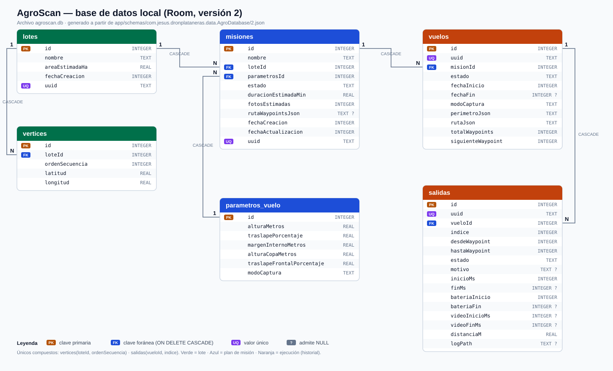
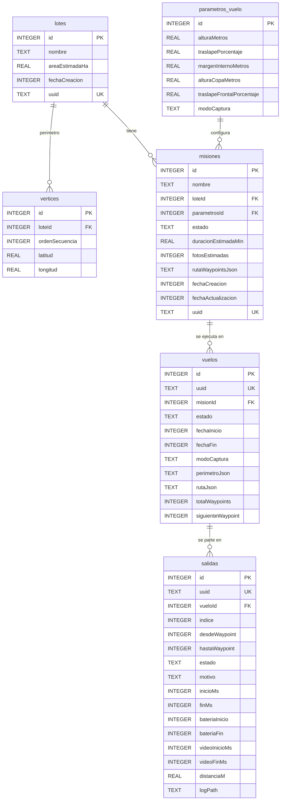

# Diagrama de la base de datos

Base local `agroscan.db` (Room, versión 2). Se genera a partir de `app/schemas/com.jesus.dronplataneras.data.AgroDatabase/2.json`.
El detalle de cada columna está en [ESTRUCTURA_DE_DATOS.md](ESTRUCTURA_DE_DATOS.md#2-base-de-datos-local-room).

> El mismo diagrama en Mermaid (se dibuja solo en GitHub, GitLab y la vista previa de Markdown de Android Studio):

## Cómo leerlo

| Color | Grupo | Para qué sirve |
|---|---|---|
| Verde | `lotes`, `vertices` | El terreno: polígonos y sus vértices |
| Azul | `misiones`, `parametros_vuelo` | El **plan**: parámetros y ruta (se puede volar muchas veces) |
| Naranja | `vuelos`, `salidas` | La **ejecución**: historial de cada vuelo y de cada batería |

- **Cardinalidades:** un lote tiene muchos vértices y muchas misiones; una misión tiene unos parámetros y muchos vuelos; un vuelo tiene muchas salidas.
- **Borrado en cascada:** todas las claves foráneas son `ON DELETE CASCADE`.
- **Únicos:** `uuid` en lotes, misiones, vuelos y salidas; `(loteId, ordenSecuencia)` en vértices; `(vueloId, indice)` en salidas.
- **Plan frente a ejecución:** `vuelos` guarda **copias** del perímetro y la ruta (`perimetroJson`, `rutaJson`) para que editar el lote o la misión después no altere el historial.
